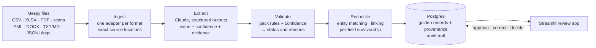

# messy-data-reconciliation-pipeline

Give it a target schema and a pile of messy files: spreadsheets, PDFs, scans, emails,
Word documents, notes and logs that describe the same real-world records. It returns
one clean, deduplicated table in which every value traces back to its source, and it
says which records need a person to look at them and why.

Claude extracts the records, rules and confidence scores decide what needs review,
fuzzy matching reconciles the sources, and a Streamlit app lets a reviewer approve or
correct the result with a full audit trail. All data is synthetic.

## The problem

The same invoice, or the same person, shows up in many places, and no two agree:

- an AP register exported as Latin-1 CSV, with `$1,234.50` amounts and three date
  formats;
- an aging report in Excel, with the header on row 4, merged cells and totals rows;
- the vendor's PDF, plus a re-sent copy and a crooked scan of it;
- a procurement export that names the vendor differently and drops the invoice number;
- emails with quoted reply chains and vCards, meeting notes, a CRM export, JSONL
  sign-up logs.

Values conflict: totals that don't add up, a stale payment status, an old phone number,
a typo in the vendor name. Some organizations have confusingly similar names but are
different companies. Anyone who has done a data migration or a customer onboarding
knows this mess. The question to answer for any such dataset is: **what are the true
records, where did each value come from, which records are duplicated or contradict
each other, and which need human review?**

## Results

Scores from real eval runs (`evals/run.py`, with the live model), compared against the
generator's ground truth. This table is written by `evals/scorecard.py` from the files
in [`evals/results/`](evals/results/); nothing in it is typed by hand.

<!-- scorecard:start -->
_No live eval run recorded yet. Run the pipeline with a real API key, then `uv run python -m evals.run --pack invoices --pack contacts --label live-seed42` and `uv run python -m evals.scorecard`._
<!-- scorecard:end -->

How the metrics are defined ([D-042](docs/decisions.md)):
- **Golden field accuracy:** each merged record against the true record, on the
  fields at least one source states. Organization names count as right when they name
  the right organization (case, accents and legal suffix ignored).
- **Extraction accuracy:** each source record against what that source actually says,
  split by format (text PDFs and scans separately).
- **Review precision:** of the records sent to review, the share that had a wrong value
  or a planted problem a person should see (a bad total, a stale status, an invoice
  missing from the register, a duplicate document).
- **Missed errors:** records approved automatically that still have a wrong value.
- **Dedupe purity / completeness:** merged records holding exactly one true record, and
  true records landing in exactly one merged record.
- **Entity match P / R:** precision and recall over pairs of organization spellings.
- **Cost per 100 docs:** model spend to produce the results, per 100 source files.

CI runs the same eval end to end with a fake model built from the ground truth, and
fails if any score drops below [`evals/baseline_fake.json`](evals/baseline_fake.json).

## Demo


| Review queue: source on the left, merged record and reasons on the right | Exceptions: every cross-source conflict, with what won and what lost |
|---|---|
|  |  |

Run it yourself with `docker compose up -d --build`, then open http://localhost:8501
(see [How to run](#how-to-run)).

## How it works



- **Schema-driven, with domain packs.** The engine knows nothing about invoices or
  contacts. A pack supplies the Pydantic model, the rules, the matching keys and the
  survivorship policies. Two packs ship (invoices and contacts) to prove it.
- **Ingest** keeps every record's exact location (file plus row, sheet, page, line or
  email part). It repairs spreadsheet structure and normalizes encodings, dates and
  amounts, keeping the original value next to the normalized one.
- **Extract** sends documents to Claude Haiku with a JSON schema generated from the pack
  model, and escalates hard documents to Claude Opus. Every field comes back with a
  confidence score and the text quoted as evidence, and that text is checked against
  the source. Spreadsheet-like sources get a column mapping proposed once per header
  layout, not one call per row. Every call is cached and costed in Postgres.
- **Validate** combines the pack's rules with confidence into `auto_approved`,
  `needs_review` or `rejected`, with a readable reason for each flag.
- **Reconcile** resolves organization names (normalization, rapidfuzz, a guard against
  lookalike names, evidence such as shared invoice-number prefixes or email domains,
  and the model or a person for close calls). It links records across sources, picks
  each field's value by a policy the pack declares, and reports every conflict.
- **Review**: a person approves or corrects in the app. Reviews survive re-runs and are
  never applied blindly to records whose sources have changed.

More detail: [`docs/architecture.md`](docs/architecture.md).

## Key decisions

Every decision, with the alternatives considered, is in
[`docs/decisions.md`](docs/decisions.md). The ones that shaped it most:

- **Generic engine, domain packs** (D-003, D-004): proving that a second kind of data
  needs no engine change.
- **Ground truth first, then the mess** (D-010): the generator plants each record across
  sources with known defects, so every stage can be scored.
- **Structured outputs plus evidence checks** (D-024, D-028): a value whose quoted
  evidence isn't in the source loses half its confidence.
- **Column mappings for structured sources** (D-023): one model call per header layout
  instead of one per row.
- **Small model first, escalate when needed, cache everything** (D-025, D-026): re-runs
  cost nothing, and the cost column above shows what a fresh run costs.
- **Lookalike guard and evidence before thresholds** (D-033): name similarity alone
  would merge "Bluewater Holdings" with "Bluewater Holding Group".
- **Per-field survivorship** (D-035): amounts by majority and arithmetic, payment status
  from the system of record, contact details from the most recent source.
- **The model decides close calls only when confident; people can always override**
  (D-036).
- **Reviews keyed by their sources** (D-038): corrections survive rebuilds and come back
  for review if the evidence underneath changes.

## Known limits

Found by the evals rather than guessed:
- A stale value that only one source states (an old job title in a single memo) can't
  be outvoted, so it can be auto-approved.
- When a typo and the correct spelling of an email appear equally often, either can
  win.
- A misread digit on a scanned invoice number can keep the scan from linking to its
  register row. It then shows up separately in review instead of being merged.

## What I'd do next for a real deployment

- **Authentication and roles:** who may approve, who may decide entity matches. Today a
  reviewer just types a name (D-040).
- **Incremental runs:** reconcile only what changed, instead of rebuilding (fine at
  this size, not at millions of records).
- **Learning from reviewers:** feed corrections and match decisions back as
  examples and into thresholds, and track review precision over time.
- **A pack per customer data model,** written with the customer's own field
  definitions and rules, plus a staging environment to run their real exports through
  before go-live.
- **Operations:** scheduled ingestion from the customer's systems, alerting on cost and
  failure rates, retention and PII handling for real data.
- **Evals on the customer's data:** a labelled sample of their records as the ground
  truth, so accuracy is measured on their mess, not mine.

## How to run

Needs Python 3.12 with [uv](https://docs.astral.sh/uv/), and Docker.

```bash
uv sync
cp .env.example .env          # set POSTGRES_PASSWORD; ANTHROPIC_API_KEY for live extraction
uv run python -m data_gen     # the synthetic corpus and its ground truth
docker compose up -d postgres
uv run python -m pipeline.run db upgrade
uv run python -m pipeline.run ingest --pack invoices data/generated/invoices
uv run python -m pipeline.run extract --pack invoices --estimate
uv run python -m pipeline.run extract --pack invoices
uv run python -m pipeline.run validate --pack invoices
uv run python -m pipeline.run reconcile --pack invoices
uv run streamlit run app/streamlit_app.py
```

Then repeat the pipeline steps with `contacts`. Tests need no API key:
`uv run pytest`. Every command, including evals and the Docker setup, is in
[`docs/howto.md`](docs/howto.md).

## Built with Claude Code

Built with [Claude Code](https://claude.com/claude-code) as a pair programmer: I made
the design decisions, and Claude Code proposed plans, wrote code and tests, and kept the
architecture, decision log and how-to current at every step. The decision log records
the reasoning behind each choice.
