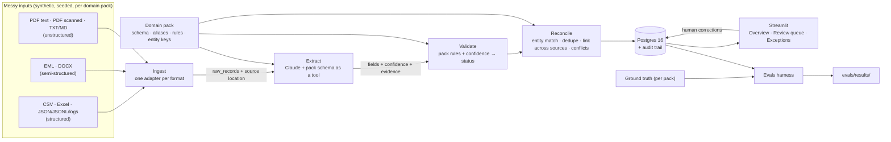

# Architecture

How the system fits together **right now**, plus the target design it is growing
toward. Update this file whenever a component is added or changed. The status column
must match the code that is actually in the repo.

## System overview (target)

The engine (ingest, extract, validate, reconcile, store, app) knows nothing about any
domain. Everything specific to a domain comes from the pack (D-004).

## Components

| Component | Location | Responsibility | Status |
|---|---|---|---|
| Data generator | `data_gen/` | Shared format writers, plus one generator per pack; writes the corpus, ground truth and a hash manifest | Planned (M1) |
| Domain packs | `src/pipeline/domains/<pack>/` | Target model, aliases, rules, entity keys | Planned (M1 for schemas, later for rules and keys) |
| Ingest | `src/pipeline/ingest/` | Format adapters → `raw_records`; normalize encodings, dates, amounts; record source location | Planned (M2) |
| Extract | `src/pipeline/extract/` | Claude structured output driven by the schema, per-field confidence and evidence, cache by content hash, token and cost log, model escalation | Planned (M3) |
| Validate | `src/pipeline/validate/` | Pack rules plus confidence → `auto_approved` / `needs_review` / `rejected`, with reasons | Planned (M4) |
| Reconcile | `src/pipeline/reconcile/` | Canonical entities (rapidfuzz), dedupe across sources, record linking, field-level conflicts | Planned (M5) |
| Store | `src/pipeline/store/` | SQLAlchemy models, Alembic migrations, audit trail | Planned (M2–M5) |
| CLI | `src/pipeline/run.py` | Run each stage or the whole pipeline | Planned |
| UI | `app/` | Streamlit: Overview, Review queue, Exceptions | Planned (M6) |
| Evals | `evals/` | Accuracy per field, pack and format; review precision; missed errors; match accuracy; cost and time | Planned (M7) |
| Infra | `docker-compose.yml`, `.github/workflows/ci.yml` | Postgres 16 locally; CI with a mocked LLM | Planned (M1) |

## Data model

Not built yet. Tables get documented here as their Alembic migrations land.

## Cross-cutting concerns

- **Traceability:** every value carries its source location from ingest through to
  the UI. A location is a file plus whichever of these applies: row, sheet/cell,
  page, line, or email part.
- **Determinism:** the generator is seeded and checked by a manifest-hash test
  (D-002). LLM calls are cached by content hash, so reruns are reproducible and cost
  nothing extra.
- **Secrets:** read from `.env` and never committed; gitleaks runs as a pre-commit
  hook.
- **Testing:** every module has tests. CI uses a mocked LLM client, so it needs no
  API key. Engine tests run against more than one pack.
