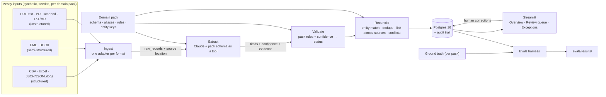
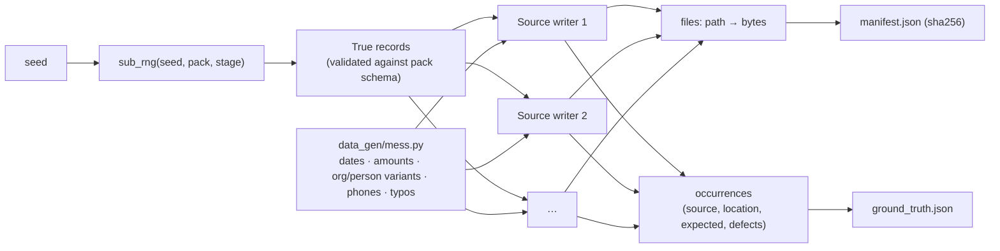
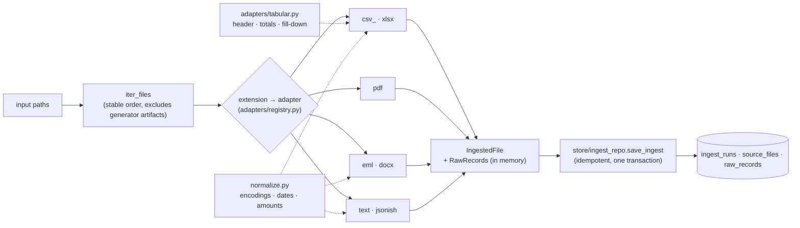
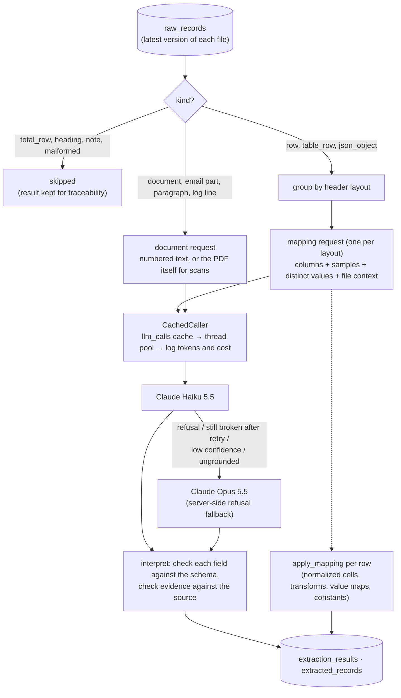
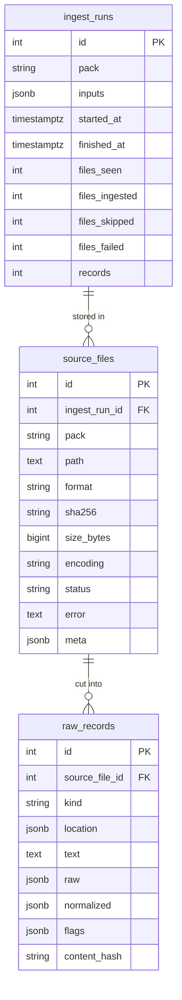
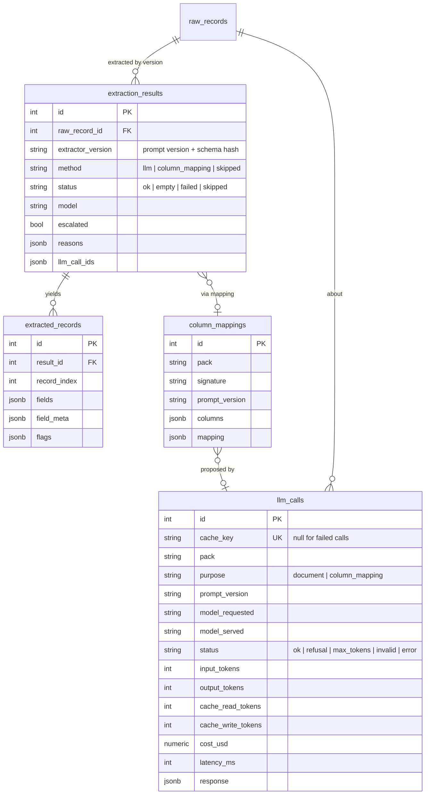

# Architecture

How the system fits together **right now**, plus the target design it is growing
toward. Update this file whenever a component is added or changed. The status column
must match the code that is actually in the repo.

## System overview (target)



The engine (ingest, extract, validate, reconcile, store, app) knows nothing about any
domain. Everything specific to a domain comes from the pack (D-004).

## Components

| Component | Location | Responsibility | Status |
|---|---|---|---|
| Data generator | `data_gen/` | Shared format writers, plus one generator per pack; writes the corpus, ground truth and a hash manifest | **Built (M1)** |
| Domain packs | `src/pipeline/domains/<pack>/` | Target model, extraction guidance, rules, entity keys | **Schemas (M1) and extraction guidance (M3) built**: `PackInfo` registry. Rules and keys come later |
| Ingest | `src/pipeline/ingest/` | Format adapters → raw records; encodings, dates, amounts normalized next to the original values; exact source locations | **Built (M2)** |
| Extract | `src/pipeline/extract/` | Claude structured outputs generated from the pack schema; per-field confidence and evidence, evidence check against the source; column mappings for structured rows; cache plus token and cost log in `llm_calls`; Haiku → Opus escalation | **Built (M3)**; live accuracy measured in M7 |
| Validate | `src/pipeline/validate/` | Pack rules plus confidence → `auto_approved` / `needs_review` / `rejected`, with reasons | Planned (M4) |
| Reconcile | `src/pipeline/reconcile/` | Canonical entities (rapidfuzz), dedupe across sources, record linking, field-level conflicts | Planned (M5) |
| Store | `src/pipeline/store/`, `migrations/` | SQLAlchemy models, Alembic migrations, audit trail | **Ingest (M2) and extraction (M3) tables built**; reconciliation and audit tables come later |
| Config | `src/pipeline/config.py` | Settings from env / `.env` (`DATABASE_URL`, `ANTHROPIC_API_KEY` as a secret) | **Built (M1)** |
| CLI | `src/pipeline/run.py` | `db upgrade/downgrade/current`, `ingest [--dry-run]`, `extract [--limit] [--estimate] [--files-root]` | **Built** for db, ingest (M2) and extract (M3) |
| UI | `app/` | Streamlit: Overview, Review queue, Exceptions | Planned (M6) |
| Evals | `evals/` | Accuracy per field, pack and format; review precision; missed errors; match accuracy; cost and time | `spot_check.py` (field accuracy of extractions so far) built in M3; full harness planned (M7) |
| Infra | `docker-compose.yml`, `.github/workflows/ci.yml`, `.pre-commit-config.yaml` | Postgres 16 locally and as a CI service container; CI runs ruff, mypy, pytest (DB tests required) and a gitleaks history scan | **Built (M1)**. Postgres 16 container verified healthy by the owner on macOS |

## Synthetic corpus (Milestone 1)

`uv run python -m data_gen` builds everything in memory, then writes
`data/generated/` (gitignored, D-002):

```
data/generated/
├── manifest.json                 # seed, generator version, sha256 + size of every file
├── invoices/
│   ├── ground_truth.json
│   ├── pdf/                      # 150 vendor PDFs + 6 planted duplicates
│   │                             #   7 layouts, ~11 multi-page, 20 scanned (image-only)
│   ├── ap_register.csv           # legacy AP: Latin-1, preamble, mixed dates, $ amounts
│   ├── procurement_export.csv    # BOM, other schema, aliases, missing refs, dup rows
│   └── ap_aging.xlsx             # title rows, fill-down groups, subtotals, serial dates
└── contacts/
    ├── ground_truth.json
    ├── email/                    # 80 .eml: signatures, reply chains, vCards, HTML parts
    ├── docx/                     # 20: contact tables, attendee lists, memos
    ├── notes/                    # 40 .txt/.md: contacts buried in prose / bullets
    ├── exports/webform_submissions.jsonl   # 3 key shapes, malformed lines, repeats
    ├── exports/signups.log       # 3 logger formats + noise
    └── crm_export.csv            # phone formats, aliases, nickname dup rows
```

How the generator works (D-010):



Each `ground_truth.json` (models in `data_gen/ground_truth.py`) contains:
- `entities`: canonical vendors or companies, the aliases planted for each, and
  `lookalike_of` for different entities with confusingly similar names.
- `records`: the clean `truth` of each record, plus its `occurrences`. An
  occurrence holds `source`, `location` (row, sheet+row, pages, line, email part,
  table+row, paragraph), `expected` (the values *this source* states), `defects`
  and `duplicate_of`.
- `duplicate_groups`: each planted duplicate set; the first entry is the original.

| Module | Role |
|---|---|
| `data_gen/build.py`, `__main__.py` | Orchestrates packs, writes files and manifest, refuses to wipe a directory it didn't create |
| `data_gen/corpus.py` | `PackOutput` accumulator, `sub_rng`, `sha256` |
| `data_gen/mess.py` | Pure mess functions shared by packs |
| `data_gen/writers/files.py` | Deterministic CSV/XLSX/DOCX/EML serialization (zip normalization) |
| `data_gen/writers/scan.py` | Text PDF → image-only "scan" (D-012) |
| `data_gen/packs/invoices/` | Vendors, catalog, 7 PDF layouts, the four invoice sources |
| `data_gen/packs/contacts/` | Companies, names, fictional phone ranges (D-013), the seven contact sources |

## Ingestion (Milestone 2)



Adapters are plain functions `(bytes, IngestedFile) -> None`, with no database
access, so they are unit-tested in isolation. One bad file is recorded as
`status=error` and the run continues.

| Format | Record kind(s) | `location` | Notable flags |
|---|---|---|---|
| CSV | `row` | `{row}` (physical line, quoted newlines handled) | encoding in `source_files.encoding`, `short_row` |
| XLSX | `row`, `total_row`, `stray_note`, `sheet_text` | `{sheet, row}` / `{sheet}` | `filled_down:<col>`, `total_row`, `stray_cell` |
| PDF | `document` | `{pages}` | `multi_page`; scans: format `pdf_scanned`, `needs_vision`, `no_text_layer` |
| EML | `email_body`, `email_quoted`, `email_attachment` | `{part: body \| quoted \| attachment:<name>}` | `quoted`, `html_only`, `binary_attachment` |
| DOCX | `paragraph`, `heading`, `table_row` | `{paragraph}` / `{table, row}` | |
| TXT / MD | `document` | `{line_start, line_end}` | `markdown` |
| JSONL | `json_object`, `malformed_line` | `{line}` | `has_nulls`, `malformed_json` |
| JSON | `json_object` | `{index}` | |
| Log | `log_line` | `{line}` | `unparsed_log_line` |

Each record carries `text` (what later stages read), `raw` (the source values
verbatim), `normalized` (typed readings: `{"type": "date"|"amount", "value", ...flags}`)
and `flags`. The acceptance test (`tests/test_ingest_corpus.py`) checks that every
ground-truth occurrence in both packs is covered by exactly one data record, and
that normalized dates and amounts match the truth.

## Extraction (Milestone 3)



| Module | Role |
|---|---|
| `extract/schema.py` | Pack Pydantic model → structured-output schema (`{records: [{field: {value, confidence, evidence}}]}`) and the mapping schema; checks each field value against the pack schema |
| `extract/prompts.py` | System prompts (document, mapping), numbered content, PDF document blocks; `PROMPT_VERSION` |
| `extract/client.py` | `LLMClient` interface, `AnthropicLLMClient` (structured outputs, `cache_control`, fallbacks for the escalation model, status handling), `cost_usd` |
| `extract/core.py` | Pure logic: interpret responses, evidence check, escalation reasons, mapping parsing and application |
| `extract/transforms.py` | Mapping transforms: dates, amounts, name splitting, E.164, ISO country |
| `extract/runner.py` | `Extractor`: pending records → mappings and documents → retries, escalation → storage; `estimate()` |
| `tests/fakes.py` | Fake LLM for CI, built from ground truth, with scriptable failures (D-027) |

Per-field metadata on every extracted record (`extracted_records.field_meta`):
`confidence` (model or mapping), `final_confidence` (after the evidence and flag
penalties), `evidence`, `grounded` (true, false, or null for scans), and `flags`
such as `grounding_failed`, `invalid_value`, `missing_year`,
`inferred_from_amount_currency` and `file_level_constant`. Record-level flags
include `missing_required:<field>`.

## Data model

Migration `0001` (`migrations/versions/0001_ingest_tables.py`):



Migration `0002` (`migrations/versions/0002_extraction_tables.py`):



- `extraction_results` is unique on `(raw_record_id, extractor_version)`: re-running
  only processes new raw records. A new prompt or schema version re-extracts
  everything, mostly answered from the `llm_calls` cache.
- `source_files` is unique on `(pack, path, sha256)`: re-ingesting is a no-op, and
  identical content under another path is stored with `meta.identical_to` (D-020).
- `meta` holds per-format details: preamble lines, header row, sheet names,
  page count, email headers.
- Deleting a source file cascades to its raw records.

## Cross-cutting concerns

- **Traceability:** every value carries its source location from ingest through to
  the UI: `source_files.path` plus `raw_records.location` (see the table above).
  `pipeline.ingest.models.location_covers()` relates a record's location to a finer
  one, such as a line inside a document or a mention inside a paragraph.
- **Determinism:** the generator is seeded and checked by a manifest-hash test
  (D-002). LLM calls are cached by content hash, so reruns are reproducible and cost
  nothing extra.
- **Secrets:** read from `.env` and never committed; gitleaks runs as a pre-commit
  hook.
- **Testing:** every module has tests. CI uses a fake LLM client built from ground
  truth, so it needs no API key. Engine tests run against both packs.
- **Cost control:** small model first, a response cache keyed on content, column
  mappings instead of per-row calls, `--estimate` before spending, and per-call
  costs in `llm_calls`.
- **Known limitation:** ingest doesn't track deleted files. A file removed from the
  source folder stays "current" until the database is reset.
