# Architecture

How the system fits together **right now**, plus the target design it is growing
toward. Update this file whenever a component is added or changed. The status column
must match the code that is actually in the repo.

## System overview (target)

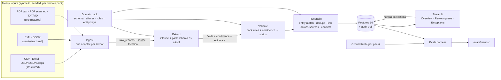

The engine (ingest, extract, validate, reconcile, store, app) knows nothing about any
domain. Everything specific to a domain comes from the pack (D-004).

## Components

| Component | Location | Responsibility | Status |
|---|---|---|---|
| Data generator | `data_gen/` | Shared format writers, plus one generator per pack; writes the corpus, ground truth and a hash manifest | **Built (M1)** |
| Domain packs | `src/pipeline/domains/<pack>/` | Target model, extraction guidance, validation rules, entity keys and survivorship policies | **Built**: schemas (M1), extraction guidance (M3), rules (M4), reconciliation specs (M5) in a `PackInfo` registry |
| Ingest | `src/pipeline/ingest/` | Format adapters → raw records; encodings, dates, amounts normalized next to the original values; exact source locations | **Built (M2)** |
| Extract | `src/pipeline/extract/` | Claude structured outputs generated from the pack schema; per-field confidence and evidence, evidence check against the source; column mappings for structured rows; cache plus token and cost log in `llm_calls`; Haiku → Opus escalation | **Built (M3)**; live accuracy measured in M7 |
| Validate | `src/pipeline/validate/` | Pack rules plus generic extraction checks → `auto_approved` / `needs_review` / `rejected`, with readable reasons | **Built (M4)**; per source, before reconciliation (D-029) |
| Reconcile | `src/pipeline/reconcile/` | Canonical entities (rapidfuzz plus a lookalike guard, close calls to Claude or a human), record linking across sources, survivorship per field, conflicts, re-validated golden records | **Built (M5)** |
| Store | `src/pipeline/store/`, `migrations/` | SQLAlchemy models, Alembic migrations, audit trail | **Built**: ingest (M2), extraction (M3), validation (M4), reconciliation (M5), review and audit (M6) tables |
| Config | `src/pipeline/config.py` | Settings from env / `.env` (`DATABASE_URL`, `ANTHROPIC_API_KEY` as a secret) | **Built (M1)** |
| CLI | `src/pipeline/run.py` | `db upgrade/downgrade/current`, `ingest [--dry-run]`, `extract [--limit] [--estimate] [--files-root]`, `validate`, `reconcile [--no-llm]` | **Built** for db, ingest (M2), extract (M3), validate (M4) and reconcile (M5) |
| Review | `src/pipeline/review/` | Approve, correct, decide name matches; re-apply reviews after each rebuild; audit trail; source previews; page queries | **Built (M6)** |
| UI | `app/` | Streamlit: Overview, Review queue, Exceptions, Guide and FAQ (thin pages over `pipeline.review`) | **Built (M6)** |
| Evals | `evals/` | Accuracy per field, pack and format; review precision; missed errors; match accuracy; cost and time | **Built (M7)**: `harness.py` + `run.py` (results in `evals/results/`), `scorecard.py` (README table), a fake-model baseline held in CI; `spot_check.py` and `reconcile_check.py` remain as quick checks |
| Infra | `docker-compose.yml`, `Dockerfile`, `.github/workflows/ci.yml`, `.pre-commit-config.yaml`, `scripts/demo.py` | Postgres 16 and the review app (`docker compose up`); Postgres as a CI service container; CI runs ruff, mypy, pytest (DB tests required), the fake-model eval baseline, the README scorecard check and a gitleaks history scan; `scripts/demo.py` captures the README screenshots | **Built (M1; app service M6)**. Postgres 16 verified by the owner on macOS; the app image built and ran in development |

## Synthetic corpus (Milestone 1)

`uv run python -m data_gen` builds everything in memory, then writes
`data/generated/` (gitignored, D-002):

```
data/generated/
├── manifest.json                 # seed, generator version, sha256 + size of every file
├── invoices/
│   ├── ground_truth.json
│   ├── pdf/                      # 150 vendor PDFs + 6 planted duplicates
│   │                             #   7 layouts, ~11 multi-page, 20 scanned (image-only)
│   ├── ap_register.csv           # legacy AP: Latin-1, preamble, mixed dates, $ amounts
│   ├── procurement_export.csv    # BOM, other schema, aliases, missing refs, dup rows
│   └── ap_aging.xlsx             # title rows, fill-down groups, subtotals, serial dates
└── contacts/
    ├── ground_truth.json
    ├── email/                    # 80 .eml: signatures, reply chains, vCards, HTML parts
    ├── docx/                     # 20: contact tables, attendee lists, memos
    ├── notes/                    # 40 .txt/.md: contacts buried in prose / bullets
    ├── exports/webform_submissions.jsonl   # 3 key shapes, malformed lines, repeats
    ├── exports/signups.log       # 3 logger formats + noise
    └── crm_export.csv            # phone formats, aliases, nickname dup rows
```

How the generator works (D-010):

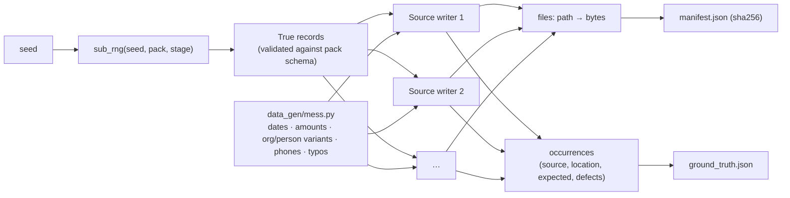

Each `ground_truth.json` (models in `data_gen/ground_truth.py`) contains:
- `entities`: canonical vendors or companies, the aliases planted for each, and
  `lookalike_of` for different entities with confusingly similar names.
- `records`: the clean `truth` of each record, plus its `occurrences`. An
  occurrence holds `source`, `location` (row, sheet+row, pages, line, email part,
  table+row, paragraph), `expected` (the values *this source* states), `defects`
  and `duplicate_of`.
- `duplicate_groups`: each planted duplicate set; the first entry is the original.

| Module | Role |
|---|---|
| `data_gen/build.py`, `__main__.py` | Orchestrates packs, writes files and manifest, refuses to wipe a directory it didn't create |
| `data_gen/corpus.py` | `PackOutput` accumulator, `sub_rng`, `sha256` |
| `data_gen/mess.py` | Pure mess functions shared by packs |
| `data_gen/writers/files.py` | Deterministic CSV/XLSX/DOCX/EML serialization (zip normalization) |
| `data_gen/writers/scan.py` | Text PDF → image-only "scan" (D-012) |
| `data_gen/packs/invoices/` | Vendors, catalog, 7 PDF layouts, the four invoice sources |
| `data_gen/packs/contacts/` | Companies, names, fictional phone ranges (D-013), the seven contact sources |

## Ingestion (Milestone 2)

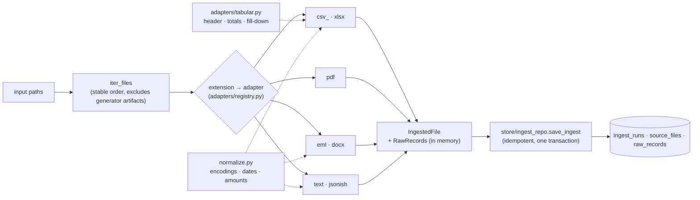

Adapters are plain functions `(bytes, IngestedFile) -> None`, with no database
access, so they are unit-tested in isolation. One bad file is recorded as
`status=error` and the run continues.

| Format | Record kind(s) | `location` | Notable flags |
|---|---|---|---|
| CSV | `row` | `{row}` (physical line, quoted newlines handled) | encoding in `source_files.encoding`, `short_row` |
| XLSX | `row`, `total_row`, `stray_note`, `sheet_text` | `{sheet, row}` / `{sheet}` | `filled_down:<col>`, `total_row`, `stray_cell` |
| PDF | `document` | `{pages}` | `multi_page`; scans: format `pdf_scanned`, `needs_vision`, `no_text_layer` |
| EML | `email_body`, `email_quoted`, `email_attachment` | `{part: body \| quoted \| attachment:<name>}` | `quoted`, `html_only`, `binary_attachment` |
| DOCX | `paragraph`, `heading`, `table_row` | `{paragraph}` / `{table, row}` | |
| TXT / MD | `document` | `{line_start, line_end}` | `markdown` |
| JSONL | `json_object`, `malformed_line` | `{line}` | `has_nulls`, `malformed_json` |
| JSON | `json_object` | `{index}` | |
| Log | `log_line` | `{line}` | `unparsed_log_line` |

Each record carries `text` (what later stages read), `raw` (the source values
verbatim), `normalized` (typed readings: `{"type": "date"|"amount", "value", ...flags}`)
and `flags`. The acceptance test (`tests/test_ingest_corpus.py`) checks that every
ground-truth occurrence in both packs is covered by exactly one data record, and
that normalized dates and amounts match the truth.

## Extraction (Milestone 3)

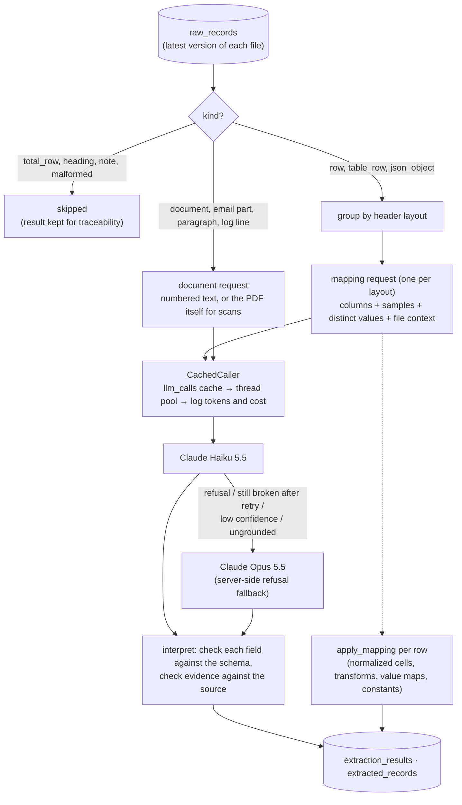

| Module | Role |
|---|---|
| `extract/schema.py` | Pack Pydantic model → structured-output schema (`{records: [{field: {value, confidence, evidence}}]}`) and the mapping schema; checks each field value against the pack schema |
| `extract/prompts.py` | System prompts (document, mapping), numbered content, PDF document blocks; `PROMPT_VERSION` |
| `extract/client.py` | `LLMClient` interface, `AnthropicLLMClient` (structured outputs, `cache_control`, fallbacks for the escalation model, status handling), `cost_usd` |
| `extract/core.py` | Pure logic: interpret responses, evidence check, escalation reasons, mapping parsing and application |
| `extract/transforms.py` | Mapping transforms: dates, amounts, name splitting, E.164, ISO country |
| `extract/runner.py` | `Extractor`: pending records → mappings and documents → retries, escalation → storage; `estimate()` |
| `tests/fakes.py` | Fake LLM for CI, built from ground truth, with scriptable failures (D-027) |

Per-field metadata on every extracted record (`extracted_records.field_meta`):
`confidence` (model or mapping), `final_confidence` (after the evidence and flag
penalties), `evidence`, `grounded` (true, false, or null for scans), and `flags`
such as `grounding_failed`, `invalid_value`, `missing_year`,
`inferred_from_amount_currency` and `file_level_constant`. Record-level flags
include `missing_required:<field>`.

## Validation (Milestone 4)

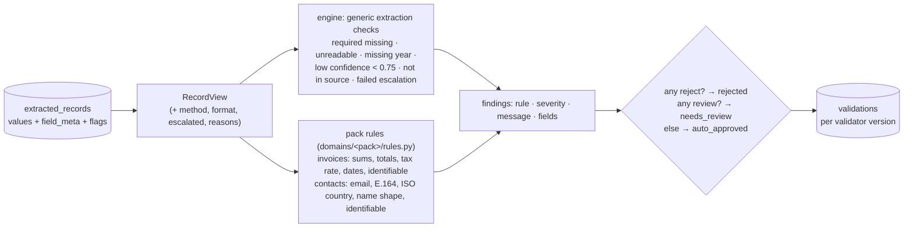

| Module | Role |
|---|---|
| `validate/types.py` | `Finding`, `RecordView`, `Rule`, severities and statuses (shared with packs) |
| `validate/engine.py` | Generic extraction checks, combining findings into a status, `validator_version` |
| `validate/runner.py` | Load the current extractor version's records, recompute and store verdicts, summary |
| `domains/invoices/rules.py`, `domains/contacts/rules.py` | Pure rule functions plus `RULES_VERSION` |

On the seed-42 corpus with the fake LLM (tests): all 8 planted bad totals, every
missing invoice reference, every date without a year, every partial contact name and
every UK national phone number go to review. Every clean text PDF that states its
currency is auto-approved.

## Reconciliation (Milestone 5)

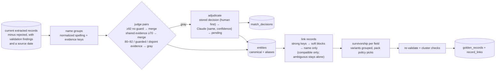

| Module | Role |
|---|---|
| `reconcile/names.py` | Normalization, similarity, lookalike guard (D-033) |
| `reconcile/entities.py` | Name groups, pair verdicts, clustering that won't chain across lookalikes, canonical names |
| `reconcile/survive.py` | Variant grouping and per-field policies → `FieldChoice` with provenance (D-035) |
| `reconcile/types.py` | `Candidate`, `ReconcileSpec` (what a pack declares) |
| `reconcile/engine.py` | Loading, source dates, adjudication, record linking, golden records, `reconcile_pack` |
| `domains/<pack>/reconcile.py` | The pack's keys, compatibility, policies, trust, cluster checks |
| `evals/reconcile_check.py` | Scores a run against ground truth (no API calls) |

On the seed-42 corpus with the fake LLM:
- **Invoices:** 694 extracted records become 300 golden records, all pure, and every
  true invoice is in exactly one of them. All 26 vendors are found and no lookalikes
  are merged. All 25 planted PDF-only invoices are flagged `not_in_ap_register`, and
  the 5 stale payment statuses resolve to the register's value with a conflict
  review.
- **Contacts:** 687 extracted records become 303 golden records, all pure; 297 of
  the 300 people are in exactly one. The 3 that stay split have no last name or
  nothing in common with their other records. All 36 companies are found and no
  namesakes are merged.

These figures are a test of the logic with a perfect extractor, not a measure of the
live system.

First live run (the owner's, 2026-10-12, real Claude extraction, seed-42 corpus,
`evals.reconcile_check`):
- **Invoices:** 694 extracted records become 302 golden records, all pure; 298 of 300
  invoices are in exactly one. No vendor pairs are wrongly merged or split. Golden field
  accuracy: PO number, subtotal, tax and due date 100%; total 99.7%; currency and
  payment status 99.6%; invoice date 98.7%; vendor name, invoice number 98.3%; line
  items 98.0%. The misses come from extraction: a misread scanned invoice number splits
  one invoice, and some long line-item tables come back empty.
- **Contacts:** 681 extracted records become 318 golden records, all pure; 283 of 300
  people are in exactly one. No namesakes or lookalike companies are merged; 6 company
  pairs the model wasn't sure about wait for a human. Field accuracy 94–99%.
- Cost of this run: extraction $0.72 for both packs; entity adjudication under $0.01.

The repeatable eval (Milestone 7) now produces these numbers; see `evals/results/`.

## Review app (Milestone 6)

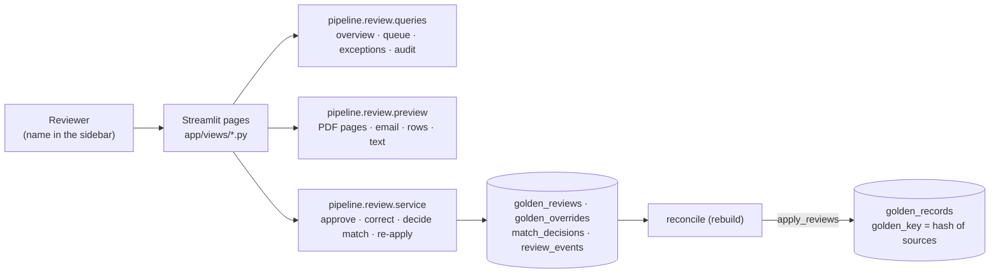

| Module | Role |
|---|---|
| `review/service.py` | Reviewer actions, input parsing against the pack schema, re-validation, `apply_reviews` (called by reconcile), orphan detection |
| `review/queries.py` | Read-only rows for each page |
| `review/preview.py` | Source previews as data: PDF pages rendered with pypdfium2, email headers and body, neighbouring rows, numbered text with evidence lines marked |
| `review/ui.py` | Streamlit helpers: session, sidebar, tables, preview rendering |
| `app/streamlit_app.py`, `app/views/` | Navigation and the pages: Overview, Review queue, Exceptions, and a Guide and FAQ (how to use each page, a glossary of statuses, review reasons, value rules and link reasons, with live counts per reason) |

- **Statuses:** a golden record is `auto_approved`, `needs_review` or `rejected` from its
  findings, or `approved` by a person. Source records keep their machine verdicts
  (D-039).
- **Corrections** are stored per field and re-applied after every rebuild. The
  record's provenance says `corrected by human:<name>` and keeps the machine value.
- **Orphans:** if the sources behind a reviewed record change, its `golden_key` changes
  and the stored review no longer matches. The new record that shares sources with it
  gets a `review_orphaned` finding and goes back to the queue (D-038).
- **Tests:** service and preview tests on the corpus, plus Streamlit `AppTest` runs of
  each page against the test database, including clicking Approve.

## Evals (Milestone 7)

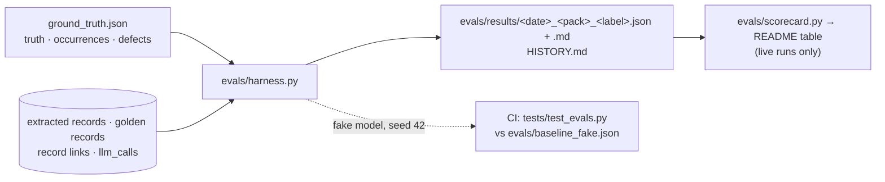

| Module | Role |
|---|---|
| `evals/harness.py` | Extraction accuracy (per field, format and method), golden accuracy, review precision, error recall, missed errors, dedupe and entity scores, cost and time per 100 documents (D-042) |
| `evals/run.py` | CLI: evaluate packs, render Markdown, save results, refresh `HISTORY.md` |
| `evals/scorecard.py` | Writes the README scorecard from saved live runs; `--check` for CI (D-044) |
| `evals/baseline_fake.json` | Scores of the fake-model run that CI must not fall below (D-043) |
| `evals/reconcile_check.py`, `evals/spot_check.py` | Quick checks from earlier milestones; the harness reuses their ground-truth matching |

The eval scores the machine's output: human corrections are reverted to the stored
machine value and statuses are recomputed from findings.

## Data model

Migration `0001` (`migrations/versions/0001_ingest_tables.py`):

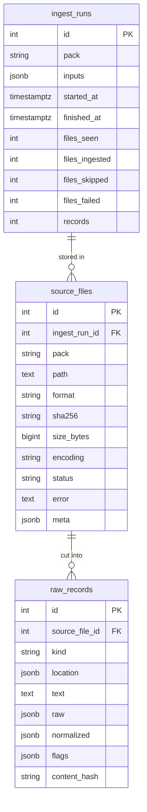

Migration `0002` (`migrations/versions/0002_extraction_tables.py`):

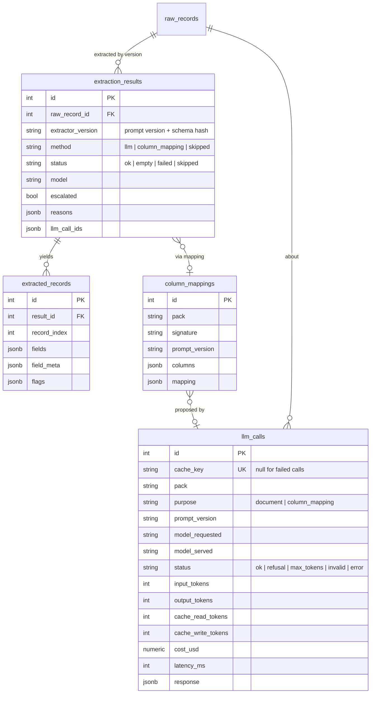

- `extraction_results` is unique on `(raw_record_id, extractor_version)`: re-running
  only processes new raw records. A new prompt or schema version re-extracts
  everything, mostly answered from the `llm_calls` cache.
Migration `0003` (`migrations/versions/0003_validations.py`): `validations`
(`extracted_record_id` FK cascade, `pack`, `validator_version`, `status`, `findings`
JSONB list of `{rule, severity, message, fields}`), unique on
`(extracted_record_id, validator_version)`, indexed on `(pack, status)`.

- `source_files` is unique on `(pack, path, sha256)`: re-ingesting is a no-op, and
  identical content under another path is stored with `meta.identical_to` (D-020).
- `meta` holds per-format details: preamble lines, header row, sheet names,
  page count, email headers.
- Deleting a source file cascades to its raw records.

Migration `0004` (`migrations/versions/0004_reconciliation.py`):

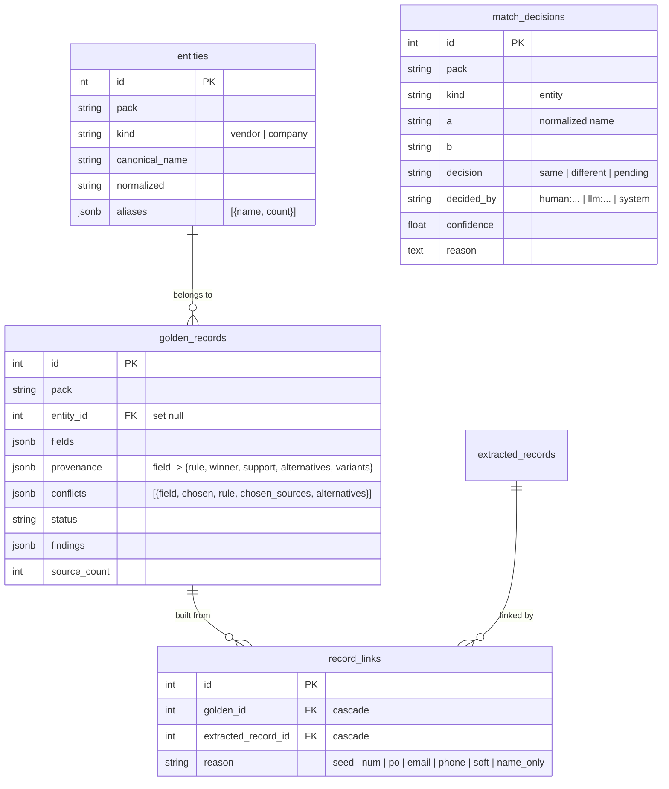

- `record_links` is indexed on `extracted_record_id` and (migration `0006`) on
  `golden_id`.
- `match_decisions` is unique on `(pack, kind, a, b)` and survives rebuilds; golden
  records, links and entities are rebuilt on every run (D-034).

Migration `0005` (`migrations/versions/0005_review.py`):

- `golden_records` gains `golden_key` (indexed; a hash of the record's sorted source
  keys `path#location#record_index`) and `source_keys`.
- `golden_reviews` (`pack`, `golden_key` unique together, `status`, `source_keys`,
  `reviewer`, `note`): approvals.
- `golden_overrides` (`pack`, `golden_key`, `field` unique together, `value` JSONB,
  `source_keys`, `reviewer`, `note`): corrected values.
- `review_events` (`at`, `actor`, `action` approve/unapprove/correct/reapply/match,
  `pack`, `target`, `field`, `old`, `new`, `note`): append-only audit trail, indexed on
  `(pack, at)`.

## Cross-cutting concerns

- **Traceability:** every value carries its source location from ingest through to
  the UI: `source_files.path` plus `raw_records.location` (see the table above).
  A golden record's `provenance` names the extracted records behind each field, and
  `record_links` leads from those to their sources.
  `pipeline.ingest.models.location_covers()` relates a record's location to a finer
  one, such as a line inside a document or a mention inside a paragraph.
- **Determinism:** the generator is seeded and checked by a manifest-hash test
  (D-002). LLM calls are cached by content hash, so reruns are reproducible and cost
  nothing extra.
- **Secrets:** read from `.env` and never committed; gitleaks runs as a pre-commit
  hook.
- **Audit:** every human action is a row in `review_events`; human decisions are never
  overwritten by a machine run.
- **Testing:** every module has tests. CI uses a fake LLM client built from ground
  truth, so it needs no API key. Engine tests run against both packs.
- **Cost control:** small model first, a response cache keyed on content, column
  mappings instead of per-row calls, `--estimate` before spending, and per-call
  costs in `llm_calls`.
- **Known limitation:** ingest doesn't track deleted files. A file removed from the
  source folder stays "current" until the database is reset.
