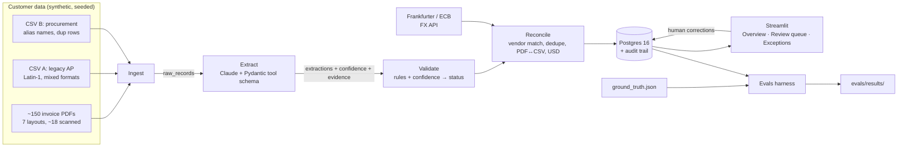

# Architecture

How the system fits together **right now**, plus the target design it is growing
toward. Update this file whenever a component is added or changed. The status column
must match the code that is actually in the repo.

## System overview (target)

## Components

| Component | Location | Responsibility | Status |
|---|---|---|---|
| Data generator | `data_gen/` | Seeded messy corpus and `ground_truth.json` | Planned (M1) |
| Ingest | `src/pipeline/ingest/` | PDFs and CSVs into `raw_records`; normalize encodings, dates, amounts; keep source file and row | Planned (M2) |
| FX client | `src/pipeline/reconcile/` (TBD) | Rate on the invoice date, weekend fallback, caching, retry | Planned (M2) |
| Extract | `src/pipeline/extract/` | Claude structured output, per-field confidence and evidence, cache by file hash, token and cost log, model escalation | Planned (M3) |
| Validate | `src/pipeline/validate/` | Rule checks plus confidence → `auto_approved` / `needs_review` / `rejected`, with reasons | Planned (M4) |
| Reconcile | `src/pipeline/reconcile/` | Canonical vendors (rapidfuzz), cross-source dedupe, PDF↔CSV matching, USD conversion | Planned (M5) |
| Store | `src/pipeline/store/` | SQLAlchemy models, Alembic migrations, audit trail | Planned (M2–M5) |
| CLI | `src/pipeline/run.py` | Run each stage or the whole pipeline | Planned |
| UI | `app/` | Streamlit: Overview, Review queue, Exceptions | Planned (M6) |
| Evals | `evals/` | Field accuracy, review precision, missed errors, match accuracy, cost and time | Planned (M7) |
| Infra | `docker-compose.yml`, `.github/workflows/ci.yml` | Postgres 16 locally; CI with a mocked LLM | Planned (M1) |

## Data model

Not built yet. Tables get documented here as their Alembic migrations land.

## Cross-cutting concerns

- **Traceability:** every record carries its source file and row, from ingest
  through to the UI.
- **Determinism:** the generator is seeded, and LLM calls are cached by file hash, so
  reruns are reproducible and cost nothing extra.
- **Secrets:** read from `.env` and never committed; gitleaks runs as a pre-commit
  hook.
- **Testing:** every module has tests. CI uses a mocked LLM client, so it needs no
  API key.
