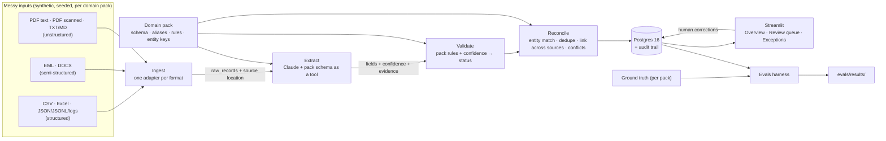
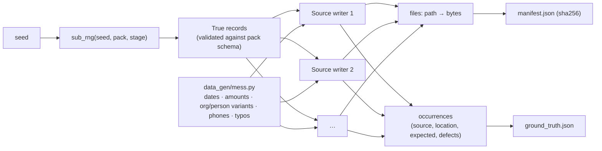

# Architecture

How the system fits together **right now**, plus the target design it is growing
toward. Update this file whenever a component is added or changed. The status column
must match the code that is actually in the repo.

## System overview (target)



The engine (ingest, extract, validate, reconcile, store, app) knows nothing about any
domain. Everything specific to a domain comes from the pack (D-004).

## Components

| Component | Location | Responsibility | Status |
|---|---|---|---|
| Data generator | `data_gen/` | Shared format writers, plus one generator per pack; writes the corpus, ground truth and a hash manifest | **Built (M1)** |
| Domain packs | `src/pipeline/domains/<pack>/` | Target model, aliases, rules, entity keys | **Schemas built (M1)**: `Invoice`, `Contact`, plus a registry. Rules and keys come later |
| Ingest | `src/pipeline/ingest/` | Format adapters → `raw_records`; normalize encodings, dates, amounts; record source location | Planned (M2) |
| Extract | `src/pipeline/extract/` | Claude structured output driven by the schema, per-field confidence and evidence, cache by content hash, token and cost log, model escalation | Planned (M3) |
| Validate | `src/pipeline/validate/` | Pack rules plus confidence → `auto_approved` / `needs_review` / `rejected`, with reasons | Planned (M4) |
| Reconcile | `src/pipeline/reconcile/` | Canonical entities (rapidfuzz), dedupe across sources, record linking, field-level conflicts | Planned (M5) |
| Store | `src/pipeline/store/` | SQLAlchemy models, Alembic migrations, audit trail | Planned (M2–M5) |
| Config | `src/pipeline/config.py` | Settings from env / `.env` (`DATABASE_URL`, `ANTHROPIC_API_KEY` as a secret) | **Built (M1)** |
| CLI | `src/pipeline/run.py` | Run each stage or the whole pipeline | Planned |
| UI | `app/` | Streamlit: Overview, Review queue, Exceptions | Planned (M6) |
| Evals | `evals/` | Accuracy per field, pack and format; review precision; missed errors; match accuracy; cost and time | Planned (M7) |
| Infra | `docker-compose.yml`, `.github/workflows/ci.yml`, `.pre-commit-config.yaml` | Postgres 16 locally; CI runs ruff, mypy, pytest and a gitleaks history scan | **Built (M1)**. Postgres 16 container verified healthy by the owner on macOS |

## Synthetic corpus (Milestone 1)

`uv run python -m data_gen` builds everything in memory, then writes
`data/generated/` (gitignored, D-002):

```
data/generated/
├── manifest.json                 # seed, generator version, sha256 + size of every file
├── invoices/
│   ├── ground_truth.json
│   ├── pdf/                      # 150 vendor PDFs + 6 planted duplicates
│   │                             #   7 layouts, ~11 multi-page, 20 scanned (image-only)
│   ├── ap_register.csv           # legacy AP: Latin-1, preamble, mixed dates, $ amounts
│   ├── procurement_export.csv    # BOM, other schema, aliases, missing refs, dup rows
│   └── ap_aging.xlsx             # title rows, fill-down groups, subtotals, serial dates
└── contacts/
    ├── ground_truth.json
    ├── email/                    # 80 .eml: signatures, reply chains, vCards, HTML parts
    ├── docx/                     # 20: contact tables, attendee lists, memos
    ├── notes/                    # 40 .txt/.md: contacts buried in prose / bullets
    ├── exports/webform_submissions.jsonl   # 3 key shapes, malformed lines, repeats
    ├── exports/signups.log       # 3 logger formats + noise
    └── crm_export.csv            # phone formats, aliases, nickname dup rows
```

How the generator works (D-010):



Each `ground_truth.json` (models in `data_gen/ground_truth.py`) contains:
- `entities`: canonical vendors or companies, the aliases planted for each, and
  `lookalike_of` for different entities with confusingly similar names.
- `records`: the clean `truth` of each record, plus its `occurrences`. An
  occurrence holds `source`, `location` (row, sheet+row, pages, line, email part,
  table+row, paragraph), `expected` (the values *this source* states), `defects`
  and `duplicate_of`.
- `duplicate_groups`: each planted duplicate set; the first entry is the original.

| Module | Role |
|---|---|
| `data_gen/build.py`, `__main__.py` | Orchestrates packs, writes files and manifest, refuses to wipe a directory it didn't create |
| `data_gen/corpus.py` | `PackOutput` accumulator, `sub_rng`, `sha256` |
| `data_gen/mess.py` | Pure mess functions shared by packs |
| `data_gen/writers/files.py` | Deterministic CSV/XLSX/DOCX/EML serialization (zip normalization) |
| `data_gen/writers/scan.py` | Text PDF → image-only "scan" (D-012) |
| `data_gen/packs/invoices/` | Vendors, catalog, 7 PDF layouts, the four invoice sources |
| `data_gen/packs/contacts/` | Companies, names, fictional phone ranges (D-013), the seven contact sources |

## Data model

No database tables yet. Tables get documented here as their Alembic migrations land.

## Cross-cutting concerns

- **Traceability:** every value carries its source location from ingest through to
  the UI. A location is a file plus whichever of these applies: row, sheet/cell,
  page, line, or email part.
- **Determinism:** the generator is seeded and checked by a manifest-hash test
  (D-002). LLM calls are cached by content hash, so reruns are reproducible and cost
  nothing extra.
- **Secrets:** read from `.env` and never committed; gitleaks runs as a pre-commit
  hook.
- **Testing:** every module has tests. CI uses a mocked LLM client, so it needs no
  API key. Engine tests run against more than one pack.
